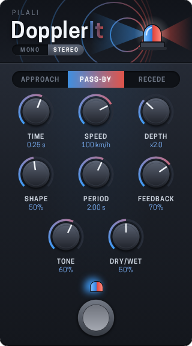

# DopplerIt



Plug-in audio de **delay Doppler** :
- **LV2** optimisé pour les **MOD Dwarf / Duo / Duo X** et le **Raspberry Pi 5**, avec un **modgui** complet pour mod-ui ;
- **VST3** (Windows, Linux, macOS) et **AU** (macOS Intel + Apple Silicon) via **JUCE**, avec une interface identique au modgui.

Les deux versions partagent exactement le même moteur DSP (`src/age_engine.hpp`), les mêmes paramètres et les mêmes **20 presets** (`src/presets.hpp`).

## Principe

C'est un delay dont chaque répétition vit son propre **passage de véhicule**, comme la
sirène d'un véhicule d'urgence. La hauteur d'une répétition ne dépend que de son **âge** :
une note jouée à n'importe quel moment reçoit exactement le même traitement, comme dans un
delay. Il n'y a ni LFO ni cycle.

- **Pass-by** : les premières répétitions arrivent plus aiguës, puis la hauteur passe par
  l'original au point de passage, et les suivantes s'éloignent plus graves.
- **Approach** : seulement l'arrivée, de l'aigu vers la hauteur d'origine.
- **Recede** : seulement l'éloignement, de la hauteur d'origine vers le grave.

Le passage dure *Period* secondes (en âge des répétitions), réparti sur *Period / Time*
répétitions, au plus 24. Ensuite, les répétitions gardent la hauteur finale jusqu'à leur
extinction.

Chaque répétition est une lecture de la même ligne à retard, transposée **une seule fois**
depuis l'original : les artefacts ne se cumulent pas d'une répétition à l'autre. Une
répétition transposée tombe à ± 15 ms de son temps nominal.

- 1 entrée, 2 sorties, avec un mode **Mono** ou **Stereo** (léger décalage de l'effet entre gauche et droite).
- Mémoire : 8 Mio à 48 kHz.
- Charge CPU, sur un cœur x86 : de 1 à 7 % selon le nombre de répétitions transposées
  (24 répétitions à l'octave en stéréo : environ 6 %).

## Contrôles

| Contrôle | Plage | Rôle |
|---|---|---|
| Mode | Approach / Pass-by / Recede | Arrivée puis éloignement, arrivée seule ou éloignement seul |
| Time | 20 ms – 1,5 s | Écart entre deux répétitions. Court : les répétitions sont denses et les paliers de hauteur se fondent en glissement. Synchronisable au tempo |
| Speed | 5 – 300 km/h | Vitesse du véhicule, donc ampleur de la transposition (réaliste : environ ± 1,4 demi-ton à 100 km/h) |
| Depth | ×1 – ×8 | Exagération de la transposition : ×1 est réaliste, jusqu'à une octave de chaque côté au maximum |
| Shape | 5 – 100 % | Part du passage occupée par le glissement de hauteur, quelle que soit la vitesse : 5 %, bascule brève au point de passage ; 100 %, glissement sur tout le passage |
| Period | 0,1 – 16 s | Durée du passage, en âge des répétitions. Synchronisable au tempo |
| Feedback | 0 – 100 % | Niveau de chaque répétition par rapport à la précédente |
| Tone | 0 – 100 % | Passe-bas sur les répétitions : chacune s'assombrit, comme sur un delay analogique |
| Dry/Wet | 0 – 100 % | Balance son direct / effet (les deux à plein niveau à 50 %) |
| Output | Mono / Stereo | Mono : le même signal sur les deux sorties. Stereo : effet légèrement décalé entre gauche et droite |
| Bypass | footswitch | Désignation `lv2:enabled`, avec un fondu sans clic |

*Speed* et *Depth* règlent l'ampleur ; *Shape* et *Period* dessinent la courbe ; *Time* fixe
la densité des répétitions.

## Presets

20 presets d'usine, identiques dans les deux versions :

| Section | Presets |
|---|---|
| Default | Default |
| Realistic | Highway Siren, Ambulance, Approaching Train, Fading Away |
| Subtle | Detuned Slapback, Slow Drift, Pitch-Drop Slap |
| Intervals | Fifth Up, Fifth Down ; Octave Swap ; Octave Fly-By ; Long Glide ; Rising Ghosts ; Dive Bomb |
| In time (120 BPM) | Quarter-Note Pass, Dotted Eighth Siren, Triplet Cascade |
| Textures | Rush Hour, Comet Tail, Deep Space |

- **mod-ui** : menu des presets du plug-in (fichiers `presets.ttl` et `manifest.ttl` du bundle).
- **JUCE** : programmes d'usine de l'hôte, et barre de presets au-dessus de la pédale
  (flèches précédent / suivant, menu par section en cliquant sur le nom).
- Les presets ne touchent ni à **Output** (Mono / Stereo, qui dépend du câblage) ni au bypass.
- Les presets « In time » sont réglés pour 120 BPM. Pour suivre le tempo, synchronisez
  *Time* et *Period* dans mod-ui (voir ci-dessous).

Les presets sont définis une seule fois dans `src/presets.hpp`. `make presets` régénère les
fichiers LV2 ; `make test` échoue s'ils ne correspondent plus au tableau.

### Synchronisation au tempo (mod-ui)

Les ports **Time** et **Period** déclarent `mod:tempoRelatedDynamicScalePoints`. Dans mod-ui :
1. ouvrez les paramètres du plug-in (icône ⚙) ;
2. cliquez sur l'icône d'assignation de **Time** ou **Period** ;
3. cochez **Tempo – Translate value to musical tempo** ;
4. choisissez la division (1/4, 1/2, 1 mesure, valeurs pointées ou en triolets), puis enregistrez.

Avec **Assign to: None**, la valeur suit simplement le tempo global, y compris en tap tempo
depuis le Dwarf.

## Compilation

Dépendances : `make`, `g++` et les en-têtes LV2 (`lv2-dev`).

### Directement sur un Raspberry Pi 5

```sh
sudo apt install build-essential lv2-dev
make                 # optimisé pour le CPU de la machine (Cortex-A76 sur Pi 5)
make install-user    # installe dans ~/.lv2
# ou : sudo make install   (installe dans /usr/local/lib/lv2)
```

Le plug-in est alors utilisable dans tout hôte LV2 (MODEP / mod-ui, Carla, Ardour,
jalv, etc.).

### Pour les MOD (Dwarf, Duo, Duo X) avec mod-plugin-builder

```sh
cp -r mod-plugin-builder/dopplerit /path/to/mod-plugin-builder/plugins/package/
cd /path/to/mod-plugin-builder
./build moddwarf dopplerit           # ou modduo, modduox
# depuis une copie locale plutôt que GitHub :
DOPPLERIT_SOURCE_DIR=/path/to/DopplerIt ./build moddwarf dopplerit
# puis pour envoyer le plug-in sur l'appareil connecté en USB :
./build moddwarf dopplerit-publish
```

La recette passe `NOOPT=true` : ce sont les options CPU de mod-plugin-builder qui
s'appliquent (Cortex-A53 pour le Dwarf et le Duo X, Cortex-A7 pour le Duo).

### Version JUCE : VST3 (Windows / Linux / macOS) et AU (macOS)

Dépendances : CMake ≥ 3.22 et un compilateur C++17 :
- Windows : Visual Studio 2022 ;
- macOS : Xcode ;
- Linux : `g++` plus les paquets X11, ALSA et freetype (voir `.github/workflows/build.yml`).

JUCE 8 est téléchargé automatiquement ; on peut aussi indiquer une copie locale avec `-DJUCE_DIR=/chemin/JUCE`.

```sh
# Windows / Linux
cmake -S juce -B build-juce -DCMAKE_BUILD_TYPE=Release
cmake --build build-juce --config Release

# macOS, binaire universel Intel + Apple Silicon (VST3 + AU)
cmake -S juce -B build-juce -DCMAKE_BUILD_TYPE=Release -DCMAKE_OSX_ARCHITECTURES="arm64;x86_64"
cmake --build build-juce --config Release
```

Les plug-ins sont générés dans `build-juce/DopplerIt_artefacts/Release/` (`VST3/DopplerIt.vst3`, `AU/DopplerIt.component`).
Ajoutez `-DDOPPLERIT_STANDALONE=ON` pour obtenir aussi une application autonome.

- **macOS minimum** : 10.11 (El Capitan) pour la partie Intel, le minimum de JUCE 8. La partie Apple Silicon démarre à macOS 11, première version pour ces Mac.
- **Entrées et sorties** : entrée mono ou stéréo (sommée en mono) ; sortie mono ou stéréo. Avec une piste de sortie mono, l'effet est automatiquement l'effet mono simple.
- **Bypass** : le footswitch est le paramètre de bypass natif de l'hôte, avec un fondu sans clic.
- **Interface** :
  - même disposition 320 × 576, mêmes couleurs et mêmes images que le modgui (filmstrip du potard, footswitch, en-tête gyrophare) ;
  - même police, Cooper Hewitt : c'est celle que mod-ui impose à tous les modgui ;
  - au-dessus de la pédale, une barre de presets tient le rôle du menu des presets de mod-ui ;
  - la fenêtre est redimensionnable de 75 % à 300 %.
- **CI GitHub Actions** : chaque push compile Linux, Windows et macOS universel, valide le VST3 avec pluginval (sévérité 10), valide l'AU avec `auval` en natif et sous Rosetta, puis publie les binaires en artefacts. Un tag `v*` crée une release.
- **Signature macOS** : les binaires de la CI sont signés ad hoc. Pour les distribuer sans avertissement de Gatekeeper, il faut une signature Developer ID et une notarisation Apple. En attendant : `xattr -dr com.apple.quarantine DopplerIt.vst3`.

> **Licence JUCE** : JUCE 8 est distribué sous AGPLv3 ou sous licence commerciale JUCE (une offre gratuite existe en dessous d'un certain chiffre d'affaires). Distribuer les binaires VST3/AU impose soit de respecter l'AGPLv3, soit de disposer d'une licence JUCE. Le code de DopplerIt reste sous MIT, et la version LV2 n'utilise pas JUCE.

### Tests et démos

```sh
make test           # tests hors ligne du moteur et des presets
make demo           # fichiers WAV de démonstration dans build/demo
make presets-demo   # chaque preset rendu sur le signal de test, dans build/presets
```

Les tests vérifient :
- la **hauteur de chaque répétition** selon la courbe, dans les trois modes, et la queue à la hauteur finale ;
- l'**invariance dans le temps** : la même note reçoit le même traitement quel que soit le moment où elle est jouée ;
- le **placement** des répétitions (± 15 ms) ;
- **Depth** (jusqu'à une octave de chaque côté) et **Shape** (même courbe quelle que soit la vitesse) ;
- l'**absence de discontinuité** lors des changements de paramètres ;
- la **stabilité**, le **mono**, le **bypass**, la **mémoire** et la **charge CPU** ;
- les **presets** : plages, noms uniques, sortie finie, et fichiers LV2 à jour.

## Structure

```
src/age_engine.hpp          moteur DSP (sans dépendance)
src/presets.hpp             presets d'usine (LV2 et JUCE)
src/dopplerit.cpp           enveloppe LV2
juce/                       version JUCE (VST3 / AU) : CMake, processeur, éditeur
.github/workflows/build.yml CI : LV2 + tests, VST3 Linux/Windows/macOS, AU macOS, pluginval, auval
dopplerit.lv2/              manifest, description des ports, presets, modgui
tests/test_age.cpp          tests hors ligne du moteur et des presets
tools/gen_presets.cpp       génère presets.ttl et manifest.ttl (make presets)
tools/render_age_demo.cpp   rendu des fichiers WAV de démonstration (make demo)
tools/render_presets.cpp    rendu de chaque preset (make presets-demo)
tools/make_gui_images.py    génère le potard (filmstrip) et le footswitch
tools/make_screenshots.mjs  capture screenshot et thumbnail depuis un mod-ui en mode dev
tools/render_modgui.mjs     même capture sans mod-ui (gabarit rempli et rendu dans Chromium)
mod-plugin-builder/         recette buildroot pour les appareils MOD
```

### modgui

Le template suit les conventions de mod-ui :
- jacks d'entrée et de sortie générés par mod-ui (`mod-role="input-audio-port"` /
  `"output-audio-port"`, avec les classes `mod-pedal-input-image` et `mod-pedal-output-image`) ;
- CSS espacé par `{{{cns}}}` et ressources chargées via `{{{ns}}}` ;
- widgets `film` et `custom-select` ;
- footswitch `mod-role="bypass"`.

Le visuel s'inspire du gyrophare, l'exemple d'effet Doppler le plus familier. La LED
de bypass est un mini-gyrophare qui clignote en bleu et rouge quand l'effet est actif.

Le modgui a été validé dans un vrai mod-ui (mode développement) : le plug-in se
charge sans erreur JavaScript, les jacks sont rendus et tous les contrôles envoient
bien leurs valeurs.

## Licence

MIT, voir [LICENSE](LICENSE). La police Cooper Hewitt embarquée dans la version JUCE est sous SIL OFL 1.1 (`juce/Assets/fonts/OFL.txt`).
